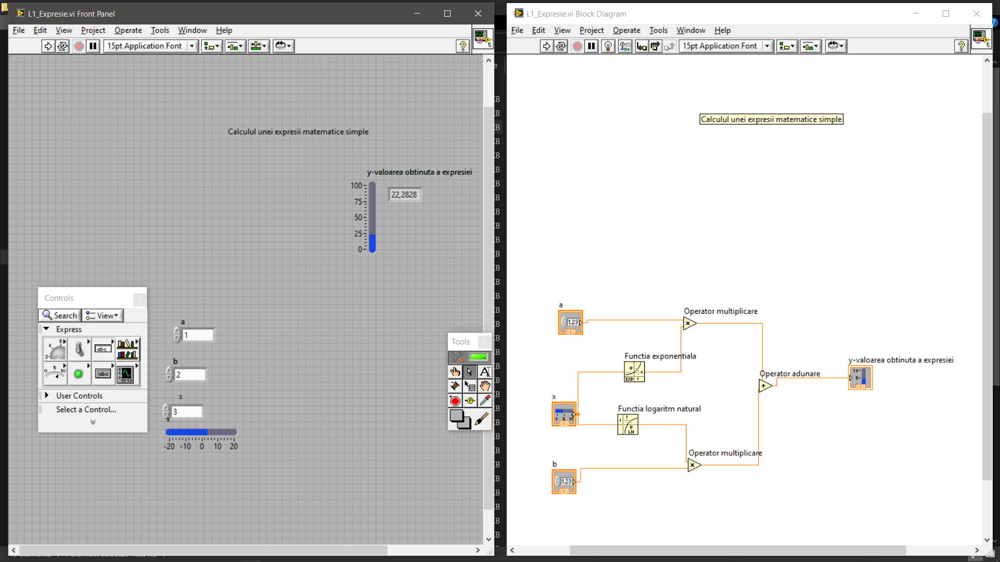
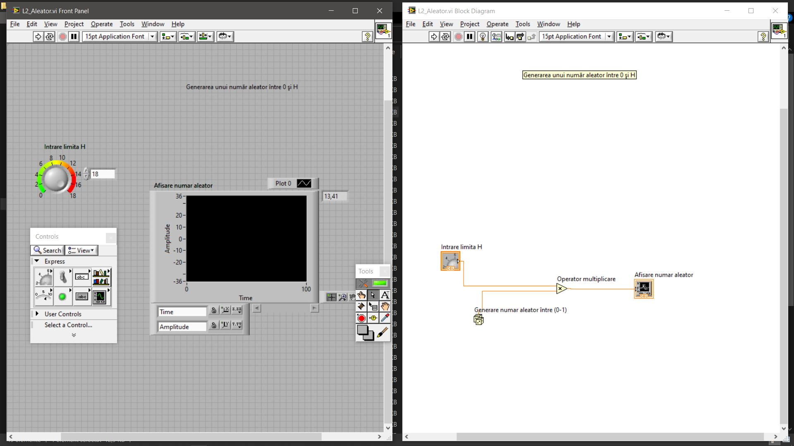

# Aplicații de calcul matematic și generare de numere aleatoare în LabVIEW
### Mathematical Calculations and Random Number Generation in LabVIEW

---

# 🇷🇴 Română

## Despre proiect

Acest proiect conține două aplicații dezvoltate în **NI LabVIEW**, având ca scop demonstrarea operațiilor matematice și a generării numerelor aleatoare folosind programarea grafică.

Proiectul include două aplicații independente:

## 1. Calculul unei expresii matematice

Prima aplicație permite calcularea unei expresii matematice pe baza a trei parametri introduși de utilizator: `a`, `b` și `x`.

Expresia calculată este:

\[
y = a \cdot e^x + b \cdot \ln(x)
\]

### Funcționalități

- Introducerea valorilor pentru parametrii `a`, `b` și `x`.
- Calcularea funcției exponențiale.
- Calcularea logaritmului natural.
- Înmulțirea rezultatelor cu parametrii corespunzători.
- Adunarea rezultatelor și afișarea valorii finale.

### Explicația Block Diagram-ului

Block Diagram-ul utilizează trei valori de intrare: `a`, `b` și `x`.

Valoarea `x` este transmisă simultan către două funcții matematice:
- **EXP:** calculează valoarea funcției exponențiale \(e^x\).
- **LN:** calculează logaritmul natural \(\ln(x)\).

Rezultatul funcției EXP este înmulțit cu parametrul `a`, iar rezultatul funcției LN este înmulțit cu parametrul `b`.

Cele două rezultate sunt apoi transmise către un operator de adunare (ADD), care calculează rezultatul final:

\[
y = a \cdot e^x + b \cdot \ln(x)
\]

Valoarea obținută este transmisă către indicatorul numeric de pe Front Panel.

### Captură de ecran – Aplicația 1



---

## 2. Generarea unui număr aleator între 0 și H

A doua aplicație generează un număr aleatoriu într-un interval stabilit de utilizator.

### Funcționalități
- Introducerea limitei superioare `H`.
- Generarea unui număr aleator folosind funcția Random Number (0-1).
- Scalarea numărului aleatoriu în funcție de limita introdusă.
- Afișarea rezultatului într-un indicator numeric.

### Explicația Block Diagram-ului

Block Diagram-ul utilizează o valoare de intrare `H`, care reprezintă limita superioară a intervalului în care se generează numărul aleator.

Aplicația folosește funcția **Random Number (0-1)**, care generează o valoare aleatorie în intervalul [0, 1).

Valoarea generată este transmisă către un operator de înmulțire (MULTIPLY), unde este înmulțită cu limita `H` introdusă de utilizator.

Calculul se realizează folosind formula:

\[
y = H \cdot r
\]

Unde:
- `H` reprezintă limita superioară introdusă de utilizator.
- `r` reprezintă numărul aleator generat în intervalul [0, 1).
- `y` reprezintă rezultatul final, cuprins în intervalul [0, H).

Rezultatul este transmis către indicatorul de afișare de pe Front Panel.

### Captură de ecran – Aplicația 2



---

## Tehnologii utilizate

- NI LabVIEW
- Graphical Programming
- Mathematical Functions
- Random Number Generation

## Structura proiectului

```text
Aplicatii-de-calcul-matematic-si-numere-aleatoare-LabVIEW/
│
├── L1_Expresie.vi
├── L2_Aleator.vi
├── Imagini/
│   ├── L1.png
│   └── L2.png
└── README.md
```

## Cerințe

- NI LabVIEW instalat.
- Sistem de operare compatibil cu versiunea LabVIEW utilizată.

## Cum se utilizează

1. Descărcați sau clonați repository-ul.
2. Deschideți fișierul VI dorit în NI LabVIEW.
3. Introduceți valorile necesare în Front Panel.
4. Rulați aplicația folosind butonul Run.
5. Vizualizați rezultatele afișate.

---

# 🇬🇧 English

## About the Project

This project contains two applications developed in **NI LabVIEW**, designed to demonstrate mathematical operations and random number generation using graphical programming.

The project includes two independent applications:

## 1. Mathematical Expression Evaluation

The first application calculates a mathematical expression based on three user-defined parameters: `a`, `b`, and `x`.

The calculated expression is:

\[
y = a \cdot e^x + b \cdot \ln(x)
\]

### Features

- Input values for parameters `a`, `b`, and `x`.
- Exponential function calculation.
- Natural logarithm calculation.
- Multiplication of the results by their corresponding parameters.
- Addition of the results and display of the final value.

### Block Diagram Explanation

The Block Diagram uses three input values: `a`, `b`, and `x`.

The value of `x` is connected to two mathematical functions:
- **EXP:** calculates the exponential function \(e^x\).
- **LN:** calculates the natural logarithm \(\ln(x)\).

The exponential result is multiplied by parameter `a`, while the natural logarithm result is multiplied by parameter `b`.

Both results are then connected to an addition operator (ADD), which calculates the final result:

\[
y = a \cdot e^x + b \cdot \ln(x)
\]

The calculated value is sent to a numeric indicator on the Front Panel.

### Screenshot – Application 1


---

## 2. Random Number Generation Between 0 and H

The second application generates a random number within a user-defined interval.

### Features
- User input for the upper limit `H`.
- Random number generation using the Random Number (0-1) function.
- Scaling the random value according to the specified upper limit.
- Displaying the generated result in a numeric indicator.

### Block Diagram Explanation

The Block Diagram uses an input value `H`, representing the upper limit of the interval in which the random number is generated.

The application uses the **Random Number (0-1)** function, which generates a random value in the interval [0, 1).

The generated value is connected to a multiplication operator (MULTIPLY), where it is multiplied by the upper limit `H` specified by the user.

The calculation is performed using the formula:

\[
y = H \cdot r
\]

Where:
- `H` represents the upper limit specified by the user.
- `r` represents the randomly generated number in the interval [0, 1).
- `y` represents the final result, within the interval [0, H).

The result is sent to the display indicator on the Front Panel.

### Screenshot – Application 2


---

## Technologies Used

- NI LabVIEW
- Graphical Programming
- Mathematical Functions
- Random Number Generation

## Project Structure

```text
Aplicatii-de-calcul-matematic-si-numere-aleatoare-LabVIEW/
│
├── L1_Expresie.vi
├── L2_Aleator.vi
├── Imagini/
│   ├── L1.png
│   └── L2.png
└── README.md
```

## Requirements

- NI LabVIEW installed.
- An operating system compatible with the installed LabVIEW version.

## How to Run

1. Download or clone the repository.
2. Open the desired VI file in NI LabVIEW.
3. Enter the required input values in the Front Panel.
4. Run the application using the Run button.
5. View the displayed results.

---

## 👤 Autor / Author

**IonutD**
